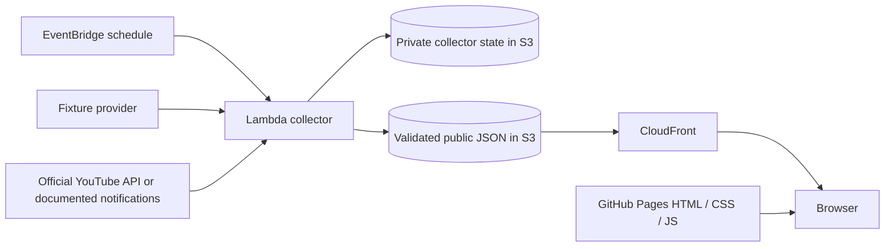

# Hosting and backend plan

Reviewed: 2026-10-26.

## Decisions

The frontend will be a free, public GitHub Pages site. The source is open
source. Scores are hidden by default. The application must be independent of
StreetBot and should put no extra collection or visitor load on its Fly app.

**Backend status: proposed, not deployed.** The recommendation is a scheduled
AWS Lambda collector with S3 persistence. Choosing the backend does not block
building the static frontend against a sample data contract.

## Why MongoDB is unnecessary

The first release has a small season dataset and one writer. It needs durable
storage, but not a database query service or access to StreetBot's personal
data. A private JSON object can hold retry state; another validated JSON
object can publish the match schedule and highlight links. Filters run in the
browser. Favourite teams and score-reveal preferences stay on the device.

Source data is public, but provider credentials remain secret. Moving the
collector out of Fly means moving those credentials to its own configuration,
not exposing them in GitHub Pages.

## Comparison

| Option | Load on StreetBot | Persistence | Operations | Fit |
| --- | --- | --- | --- | --- |
| Existing Fly app | Collector CPU, memory, network and deployment coupling; visitor traffic too if serving its API | Existing Mongo or separate object storage | Fewest new services, but retains bot uptime and scheduling dependencies | Poor fit for the requested separation |
| Lambda + EventBridge + S3 | None | Small S3 objects, no Mongo | Initial IAM, scheduler, storage, CDN and logging setup; then scheduled executions | Recommended for an independent, recoverable collector |
| GitHub Actions collector + Pages snapshots | None | Explicit durable state required; never depend only on runner disk or evictable Actions caches | Simplest initial setup, secrets in Actions, snapshot deployment after successful runs | Viable low-infrastructure alternative if refresh timing is best-effort |
| Cloudflare Worker + Cron + KV/R2 | None | KV/R2, no Mongo | Compact deployment, but runtime and CPU limits need validation | Alternative if preferring Cloudflare; do not assume a multi-feed parser fits the free CPU budget |

GitHub documents that scheduled Actions can be delayed or dropped under load,
and public-repository schedules are disabled after 60 days without repository
activity. Since missed updates are the original problem, use Actions for
testing/deployment rather than the preferred production scheduler.

Cloudflare currently lists a 10 ms CPU limit per free Cron invocation, excluding
network waits. Parsing and matching multiple feeds should be measured before
choosing that plan. It is not a drop-in assumption that every Node dependency
or workload will fit.

## Recommended data flow

- EventBridge starts collection every 15-30 minutes; the collector decides
  which sources are due. Refresh the season periodically, recent/upcoming
  matches more often, and pending highlights after matches finish.
- Lambda runs outside a VPC unless a real private-network dependency appears.
  This workload needs public HTTPS APIs, not a VPC or NAT gateway.
- Use one collector with reserved concurrency of one, bounded runtime, and
  idempotent updates. Keep retries bounded and avoid overlapping deployments.
- S3 stores durable state, so restarts do not forget unfinished matches.
- Use separate private state and public snapshot prefixes. CloudFront origin
  access is limited to the public snapshot prefix; block direct public S3
  access. Public reads never expose raw provider responses or diagnostics.
- Serve JSON over HTTPS through CloudFront, with CORS allowing the Pages origin
  (`https://joellimrl.github.io`) and a short cache lifetime. CORS is browser
  behaviour, not protection for data intended to be public.
- No API Gateway, public Lambda endpoint, MongoDB or server per visitor is
  required. A website visit only fetches static assets and a cached snapshot.
- Store API credentials in protected Lambda configuration or a secret service;
  never send them to the browser. Use least-privilege IAM and GitHub OIDC for
  later AWS deployment rather than long-lived AWS credentials in the repo.

## Persistence, failure recovery and freshness

Separate collector state from the public response. A proposed public contract
contains `schemaVersion`, `generatedAt`, `lastFixtureSuccessAt`,
`lastHighlightSuccessAt`, a source-health summary and a list of matches. Each
match has a stable provider ID, season, team identifiers/names, UTC kickoff,
status, scores and zero or more verified highlight links. Scores in a public
snapshot are not secret; spoiler protection is a presentation preference.

Private state holds per-match attempts, retry deadlines, candidate matching
decisions and source fetch metadata. Avoid storing unnecessary raw API data.

Publish only a validated snapshot. Never replace valid fixtures with an empty
list after an upstream failure. Preserve old data with its actual success
timestamps, so the frontend can show staleness. Fixture sync and highlight
discovery can succeed independently; expose both timestamps.

S3 object writes publish a complete object. Use conditional writes/ETags to
reject stale state updates. State and public snapshot writes are not a single
transaction: make publication reconstructable from durable state so a crash
between writes is repaired on the next run. Set version/lifecycle retention
deliberately, including provider data-retention obligations.

Retry transient network/5xx errors and honour rate-limit retry instructions.
Treat invalid credentials as configuration errors. EventBridge delivery
retries do not replace handling Lambda execution errors: configure Lambda
asynchronous failure handling as well, then rely on persisted retry state for
recovery on the next scheduled run. Log structured outcomes with bounded
retention and monitor the last successful publication.

Keep unresolved highlights eligible for retries for at least seven days,
tapering frequency. Reject ambiguous video associations instead of attaching
the first substring match. Use stable channels, team aliases and publication
timing. A pending match should not disappear because it is over 26 hours old.

## Cost shape

At a 15-minute cadence there are 2,880 scheduled runs in a 30-day month. As an
illustrative budget, 30 seconds per run at 512 MB is 43,200 GB-seconds/month,
before retries. These are assumptions for sizing, not measured performance.

AWS currently lists a Lambda allowance of 1 million requests and 400,000
GB-seconds/month, and 14 million EventBridge Scheduler invocations/month.
Check actual account eligibility, shared account usage and region pricing.
S3, CloudFront, logs and secret storage can still incur charges. This should
be a small workload, but it is not a promise of a zero-cost deployment.

An in-process Fly collector could also be cheap in absolute terms; its main
drawback here is sharing resources and failure paths with StreetBot.

## Implementation order

1. **Repository and Pages foundation:** source licence, static starter,
   deployment workflow and this comparison. No live data is included.
2. **Portable collector:** fixture adapter, normalized snapshot contract,
   retryable matching and offline tests. Keep provider logic separate from AWS
   entry points and storage adapters so hosting can change later.
3. **Selected backend:** provision by infrastructure-as-code, configure its
   dedicated provider credentials, persistent state, retries and health
   signals; publish the first validated snapshot.
4. **Frontend:** upcoming/results/highlights views, filters, Singapore time,
   score reveal and freshness indicators. Read the public snapshot only.
5. **Cutover:** validate over a complete matchweek, then disable StreetBot's
   `youtubePLFeed` job through its supported configuration and remove only
   feature-specific wiring. Until then, existing StreetBot work remains live.

Historical import is optional. If wanted, perform a one-time, reviewed export
of relevant highlight records, validate their match IDs and current URLs, and
import them. Do not give the deployed collector ongoing MongoDB access.

## Public-site constraints

Use team names and original graphics unless asset rights are established.
Include football-data.org attribution. Keep videos on official YouTube
channels and link out; do not download or rehost them. Review the exact
metadata-free link presentation against YouTube's requirements before building
spoiler-free video cards. API metadata must follow refresh/deletion rules;
public Git commits are not an appropriate permanent metadata archive.

Publishing the application under MIT does not relicense third-party content.
Fork operators supply their own provider credentials and observe provider terms.

## Sources

- [GitHub Pages deployment workflows](https://docs.github.com/en/pages/getting-started-with-github-pages/using-custom-workflows-with-github-pages)
- [GitHub Actions schedule limitations](https://docs.github.com/en/actions/reference/workflows-and-actions/events-that-trigger-workflows#schedule)
- [EventBridge scheduling for Lambda](https://docs.aws.amazon.com/lambda/latest/dg/with-eventbridge-scheduler.html)
- [S3 conditional writes](https://docs.aws.amazon.com/AmazonS3/latest/userguide/conditional-writes.html)
- [CloudFront access to private S3 origins](https://docs.aws.amazon.com/AmazonCloudFront/latest/DeveloperGuide/private-content-restricting-access-to-s3.html)
- [Lambda pricing](https://aws.amazon.com/lambda/pricing/)
- [EventBridge pricing](https://aws.amazon.com/eventbridge/pricing/)
- [Cloudflare Workers limits](https://developers.cloudflare.com/workers/platform/limits/)
- [Football-data.org terms](https://www.football-data.org/about)
- [YouTube developer policies](https://developers.google.com/youtube/terms/developer-policies)
- [YouTube presentation guidance](https://developers.google.com/youtube/terms/developer-policies-guide)
